# ThoughtFlow 사용 설명서

> **한 줄 요약**: 생각을 **Box**에 적고, **선(Route)** 으로 이어서, 내 생각이 어떻게 흘러갔는지 한눈에 봅니다.

```
[처음 생각] ──▶ [해 본 행동] ──▶ [결과] ──▶ [그래서 든 생각] ──▶ …
```

저장 버튼은 신경 쓰지 않아도 됩니다. **무엇을 하든 자동으로 저장**되고, 모든 파일은 **이 PC 안에만** 저장됩니다.

---

## 💾 설치하기 (Windows 10/11)

1. **[다운로드 페이지](https://github.com/hoje05/web/releases/latest)** 를 엽니다.
2. 아래쪽 **Assets** 에서 **`ThoughtFlow-Setup-버전.exe`** 를 눌러 받습니다.
3. 받은 파일을 실행합니다.
   파란 창 **“Windows의 PC 보호”** 가 뜨면 → **추가 정보** → **실행** 을 누르세요.
   (서명 인증서가 없어서 뜨는 안내예요. 바이러스라는 뜻이 아니에요)
4. 설치 폴더를 고르고 **설치** → 시작 메뉴의 **ThoughtFlow** 로 켜면 끝!

> 새 버전이 나오면 같은 방법으로 설치하면 됩니다. 만들어 둔 프로젝트는 그대로 남아요.

---

## 📌 3분 만에 시작하기

| 순서 | 이렇게 하세요 | 결과 |
|:---:|---|---|
| **1** | 빈 곳을 **더블클릭** | 새 Box가 생기고 바로 글을 쓸 수 있어요 |
| **2** | 생각을 적고 **Esc** | Box 완성 |
| **3** | Box **테두리**에 마우스를 대고 **끌어서** 빈 곳에 놓기 | 선이 이어진 새 Box가 생겨요 |
| **4** | 다음 생각을 적고 **Esc** | 흐름 완성! 3번을 반복하세요 |

> 💡 **테두리 vs 가운데**
> Box **가운데**를 끌면 → Box가 **움직여요**
> Box **테두리**를 끌면 → **선이 나와요** (마우스가 `+` 모양으로 바뀌면 테두리예요)

---

## 🧭 화면 둘러보기

```
┌─────────────────────────────────────────────────────────────┐
│ [▣] 프로젝트 이름 · 자동 저장됨          ✦AI  ⋯  ─  □  ✕  │ ← 프로그램 바
├──────┬──────────────────────────────────────┬───────────────┤
│ Box  │                                      │  탭  탭  탭   │
│      │        생각을 그리는 보드              │───────────────│
│Route │   [생각] ──▶ [행동] ──▶ [결과]        │  제목          │
│      │                                      │  메모 쓰는 곳   │
│ 도구  │                          −100%+ ⛶ ? │  (오른쪽 창)    │
└──────┴──────────────────────────────────────┴───────────────┘
```

| 위치 | 이름 | 하는 일 |
|---|---|---|
| 왼쪽 위 `▣` | 프로젝트 버튼 | 프로젝트 목록 열기 / 새 프로젝트 |
| 위쪽 `✦ AI` | AI 버튼 | Claude · ChatGPT 연결 |
| 왼쪽 | 도구 막대 | Box 만들기, Route(자유 선) 그리기, **정렬** |
| 오른쪽 | 생각 창 | Box의 긴 메모 쓰기 |
| 오른쪽 아래 | 확대 · 축소 · `?` | 화면 크기 조절, 앱 안 도움말 |

---

## ✏️ Box — 생각 하나 = Box 하나

| 하고 싶은 것 | 방법 |
|---|---|
| 만들기 | 빈 곳 **더블클릭** (또는 왼쪽 **Box** 버튼을 끌어다 놓기) |
| 글 고치기 | Box 클릭 후 **Enter** (끝낼 때 **Esc**) |
| 옮기기 | Box **가운데**를 끌기 |
| 지우기 | Box **우클릭 → 삭제** (또는 `Delete`) |
| 다음 Box로 바로 이동하며 쓰기 | 글 쓰는 중 **Tab** (이전 Box는 **Shift+Tab**) |

### 긴 생각은 오른쪽 창에

Box를 **클릭**하면 오른쪽에 창이 열립니다. 여기에 이유, 느낌, 자세한 내용을 마음껏 적으세요.

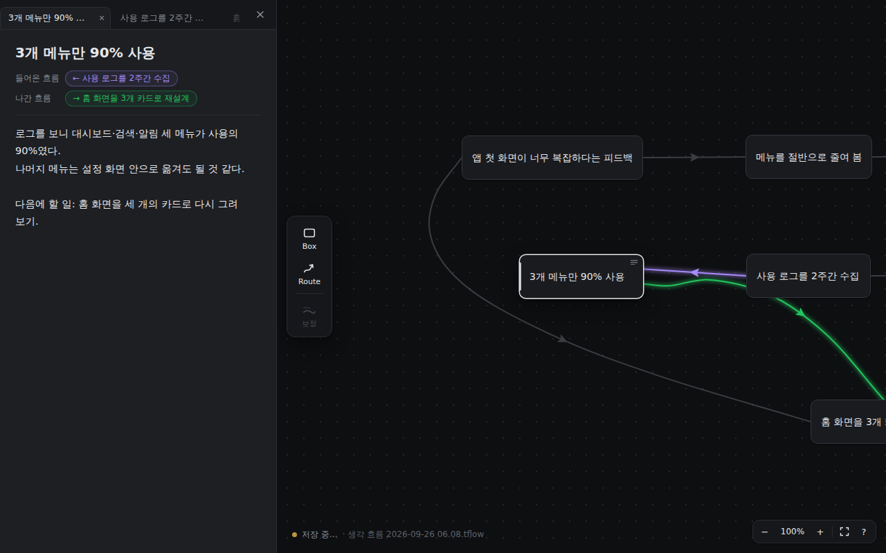

- 창 위쪽 **탭**을 누르면 다른 Box의 창으로 바로 넘어가요.
- 탭이 많아 다 안 보이면, 탭 줄의 **아무 곳이나 꾹 누른 채 좌우로 끌어** 보세요. 스마트폰 화면을 밀듯이 탭 목록이 따라 움직여요. (살짝 누르기만 하면 그 탭이 열려요)
- 창을 **×** 로 닫으면, 다음부터는 Box를 **더블클릭**해야 다시 열려요.
- 창 왼쪽 가장자리를 끌면 폭을 바꿀 수 있어요.

### ✨ 메모 꾸미기 (Notion처럼)

메모는 **한 줄이 한 블록**이에요. 줄 맨 앞에서 이렇게 입력하면 모양이 바로 바뀌어요.

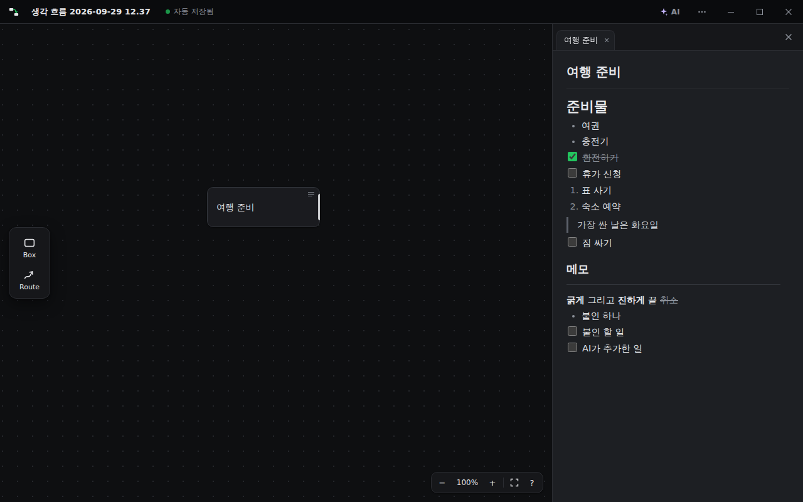

| 이렇게 입력 | 결과 |
|:---:|---|
| **`/`** | 블록 메뉴가 나와요 (제목 · 목록 · 할 일 · 인용 · 코드 · 구분선 · **그림** · **그래프**). 글자를 치면 찾아 주고, `Enter`로 골라요 |
| `# ` | 큰 제목 (`## ` 중간, `### ` 작은 제목) |
| `- ` | • 글머리 목록 |
| `1. ` | 1. 번호 목록 |
| `[] ` | ☐ 할 일 — 네모를 누르면 ☑ 체크! |
| `> ` | 인용 |
| `---` | 구분선 |
| `**글**` | **굵게** (`Ctrl+B`도 돼요) |

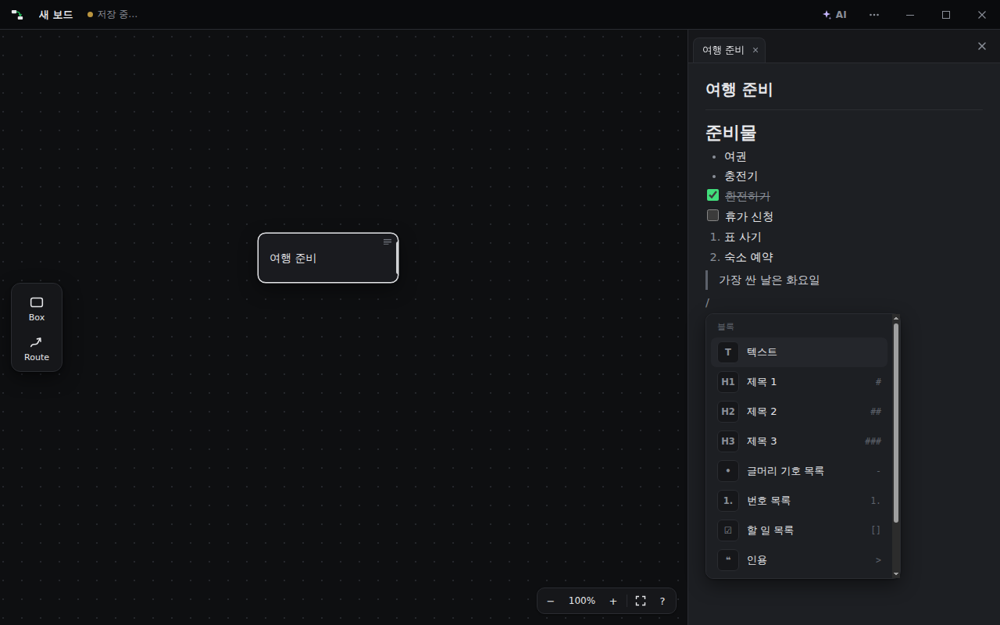

- 글자를 드래그해서 고르면 위에 **서식 막대**(굵게 · 기울임 · 취소선 · 코드)가 나와요.
- 목록을 끝내려면 빈 줄에서 `Enter`를 한 번 더 누르세요.
- 원래 쓰던 단축키는 메모를 쓰는 중에도 그대로예요 (`Ctrl+S` 저장, `Ctrl+F` 찾기, `Esc` 나가기, `Tab` 다음 칸 등).

### 🖼️ 메모 안에 그림 · 📊 그래프

글 사이에 사진이나 그래프를 넣을 수 있어요.

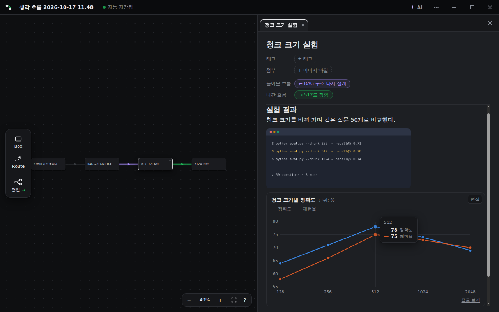

| 넣고 싶은 것 | 이렇게 하세요 |
|---|---|
| 캡처한 그림 | 메모를 쓰다가 **Ctrl+V** |
| 사진 파일 | 탐색기에서 메모 칸으로 **끌어다 놓기**, 또는 `/그림` → 파일 고르기 |
| 그래프 | `/그래프` → 예시가 들어가고 **자료 칸**이 열려요. 숫자를 고치면 바로 다시 그려져요 |

- 그림 위에 마우스를 올리면 **S · M · L** (작게 · 중간 · 크게) 단추가 나와요. **두 번 누르면** 크게 봐요.
- 그래프는 **편집**으로 자료 칸을 열고 **완료**(또는 `Esc`)로 닫아요. 마우스를 올리면 값이 보이고, **표로 보기**로 숫자를 표로 볼 수 있어요.
- 그래프 자료 칸은 이렇게 써요. 맨 위 세 줄은 없어도 돼요.
  ```
  type: line        ← bar(막대) · line(꺾은선) · pie(원)
  title: 몸무게 기록
  unit: kg
  날짜, 몸무게
  1주, 70
  2주, 69.2
  3주, 68.5
  ```
  엑셀에서 표를 복사해 붙여 넣어도 돼요. 이름 칸을 늘리면(`날짜, 나, 동생`) 선이나 막대가 여러 개가 돼요.
- AI에게 **"이 결과를 그래프로 메모에 넣어줘"** 라고 해도 돼요.
- 메모에 넣은 그림도 첨부처럼 **`프로젝트 이름.assets`** 폴더에 복사돼서 이 PC 안에만 있어요.

### 🏷️ 태그 — 생각에 이름표 붙이기

오른쪽 창 제목 아래 **태그** 줄에서 Box에 이름표를 여러 개 붙일 수 있어요.

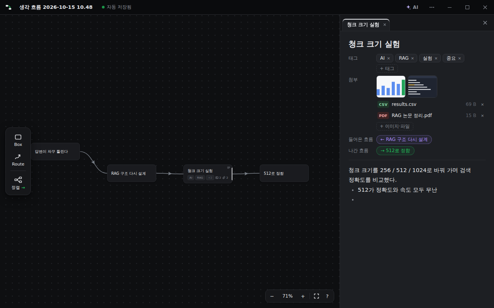

| 하고 싶은 것 | 방법 |
|---|---|
| 새 태그 | **+ 태그** → 이름 쓰고 **Enter** (계속 이어서 쓸 수 있어요, 끝낼 때 `Esc`) |
| 전에 만든 태그 다시 쓰기 | 글자 몇 개만 치면 저장된 태그가 나와요 → 클릭 (또는 `↑` `↓` + `Enter`) |
| 이 Box에서 떼기 | 태그 옆 **×** (다른 Box의 태그는 그대로) |
| 저장된 태그 지우기 | `⋯` → 편집 → **저장된 태그 관리** → 지우기 |

- `AI`, `ai`, `Ai`는 같은 태그로 봐요. 중복으로 생기지 않아요.
- 저장된 태그를 지워도 **이미 붙어 있는 Box에서는 사라지지 않아요** (점선으로 보여요). 앞으로 추천에만 안 나와요. 같은 이름을 다시 쓰면 되살아나요.
- 보드의 Box에는 태그 두 개와 `+3`처럼만 작게 보여요.

### 📎 첨부 — 사진과 자료 붙이기

오른쪽 창의 **첨부** 줄에 사진이나 자료 파일을 붙일 수 있어요.

| 방법 | 이렇게 하세요 |
|---|---|
| 파일 고르기 | **+ 이미지·파일** → 파일 선택 (여러 개 가능) |
| 끌어다 놓기 | 탐색기에서 파일을 오른쪽 창이나 보드의 **Box 위로** 끌어다 놓기 |
| 붙여 넣기 | 캡처한 이미지를 복사한 뒤 오른쪽 창에서 **Ctrl+V** |

- **사진**(PNG · JPG · WebP)은 작은 그림으로 보이고, 누르면 크게 봐요. `←` `→` 로 넘기고 `Esc`로 닫아요.
- **CSV**는 표로, **JSON · 메모장 파일**은 글자로 바로 보여요. **PDF** 같은 다른 파일은 누르면 PC의 기본 프로그램으로 열려요.
- 보드의 Box에는 그림 대신 🖼 2 · 📎 3 처럼 **개수만** 작게 보여요.
- 첨부 옆 **×** 로 빼고, 실수했으면 `Ctrl+Z`.
- 붙인 파일은 프로젝트 파일 옆의 **`프로젝트 이름.assets`** 폴더에 복사돼서 이 PC 안에만 있어요. 원본 파일은 그대로예요.

---

## ➡️ Route — 생각을 잇는 선

| 하고 싶은 것 | 방법 |
|---|---|
| 새 생각 이어 붙이기 | Box **테두리**에서 끌어 **빈 곳**에 놓기 |
| 있는 Box끼리 잇기 | Box **테두리**에서 끌어 **다른 Box 위**에 놓기 |
| 자유롭게 그리기 | 왼쪽 **Route** 버튼(또는 `R`) → 아무 데나 그리기 → 양 끝에 Box가 자동으로 생겨요 |
| 방향 바꾸기 | 선 가운데의 **화살표 클릭** |
| 지우기 | 선 **우클릭 → 삭제** |

✨ **대충 그려도 괜찮아요.** 삐뚤빼뚤한 선은 자동으로 매끈해지고, Box를 옮기면 선이 알아서 따라와 다시 이어집니다.

| 그리자마자 자동 정리 | Box를 옮기면 선도 따라와요 |
|---|---|
| 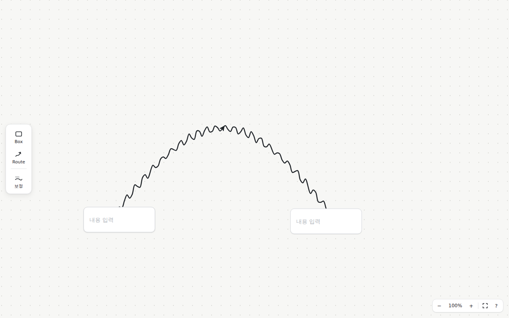 | 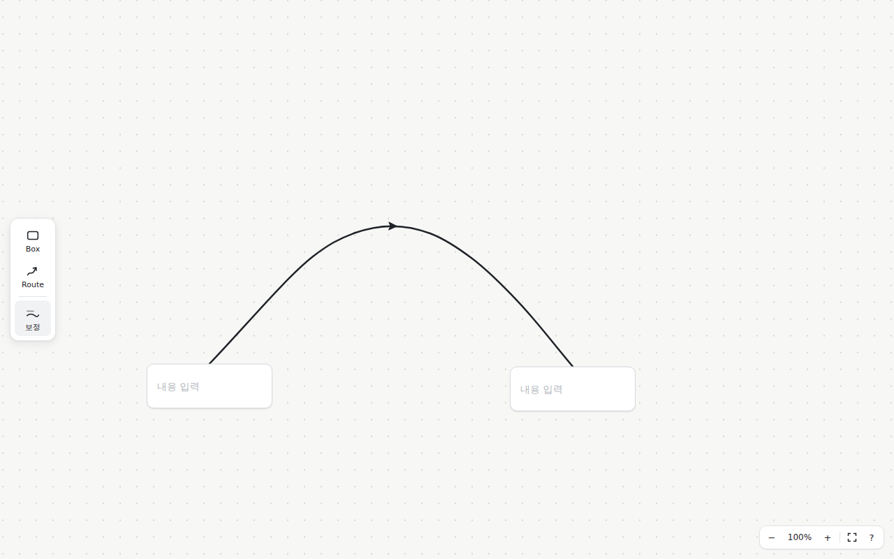 |

### 흐름 따라가기 (색깔 뜻)

Box를 클릭하면:

- 🟣 **보라색 선** = 이 생각으로 **들어온** 흐름 (원인, 이전 생각)
- 🟢 **초록색 선** = 이 생각에서 **나간** 흐름 (결과, 다음 행동)

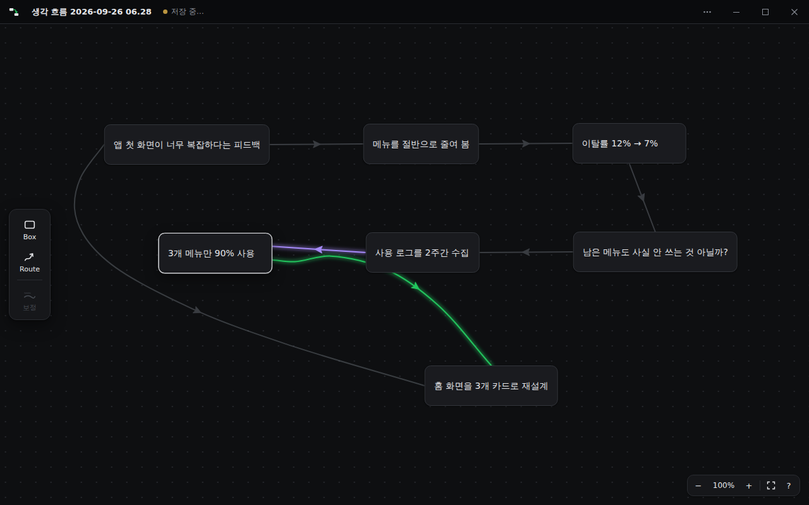

---

## 🧹 정렬 — 한 번에 보기 좋게

Box를 여기저기 만들다 보면 선이 얽히고 복잡해지죠. 왼쪽 도구 막대의 **정렬** 버튼을 누르세요.

| 정렬 전 | 정렬 후 |
|---|---|
| 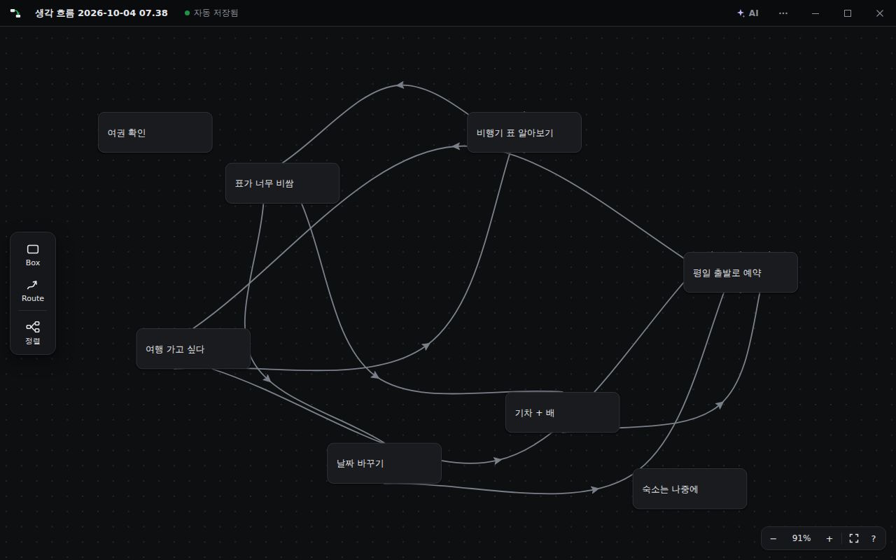 | 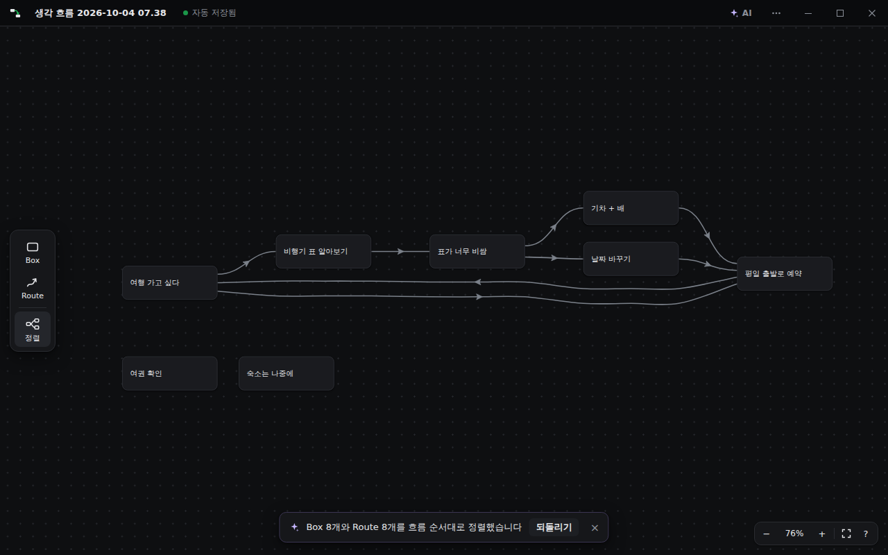 |

- 생각의 흐름대로 **왼쪽 → 오른쪽**으로 차례차례 놓여요.
- 갈라지는 생각은 위아래로 나란히, 선은 Box를 피해서 지나가요.
- 선이 없는 Box는 맨 아래에 한 줄로 모여요.
- 마음에 안 들면 **`Ctrl+Z` 한 번**(또는 아래 알림의 **되돌리기**)으로 원래대로!

### 한 번 더 누르면: 들어오는 흐름 중심 (`정렬 ←`)

정렬 버튼은 누를 때마다 바뀌어요. 버튼의 화살표를 보세요.

| 버튼 | 무엇을 하나요 |
|---|---|
| **정렬 →** (초록) | 생각이 **나가는 흐름** 순서대로 (처음엔 항상 이것) |
| **정렬 ←** (보라) | **고른 Box로 들어오는 흐름**을 중심으로. “이 생각은 어디에서 왔지?”가 한눈에 보여요 |

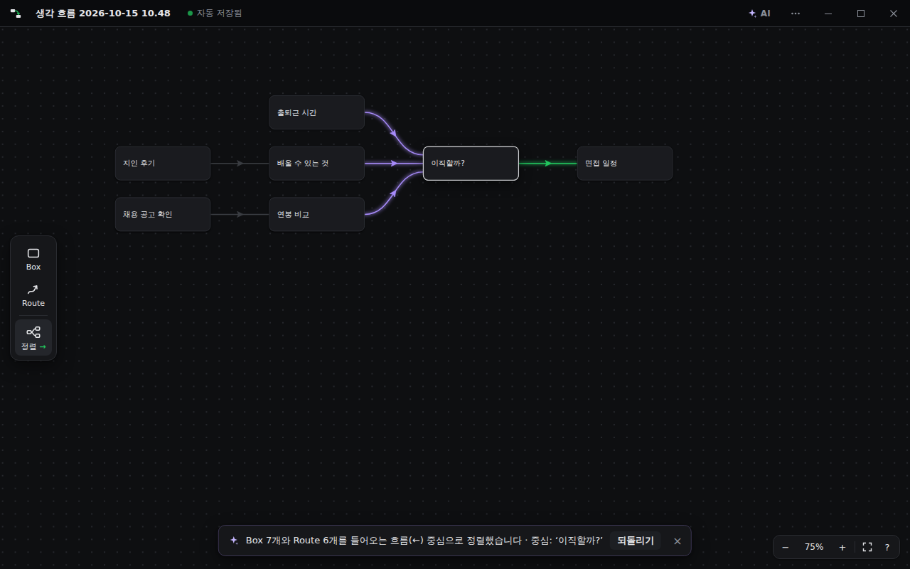

1. 궁금한 Box를 **클릭**해서 고르고
2. **정렬**을 눌러(→) 한 번, 다시 눌러(←) 한 번
3. 고른 Box가 오른쪽 중심에, 그 Box로 들어온 생각들이 바로 앞에 모이고, 그 앞의 생각은 더 왼쪽에 놓여요.

- Box를 고르지 않았으면 흐름이 가장 많이 모이는 마지막 Box가 중심이 돼요.
- 정렬은 **위치만** 바꿔요. 선의 방향이나 연결, 글, 태그, 첨부는 절대 바뀌지 않아요.

---

## 🗂️ 프로젝트 — 주제별로 나눠 쓰기

"여행 계획", "회사 일", "공부" 처럼 **주제마다 따로** 관리할 수 있어요.

1. 왼쪽 위 **▣ 버튼** 클릭 → 왼쪽에서 프로젝트 창이 나와요.
2. **+ 새 프로젝트** (또는 `Ctrl+N`) → **텅 빈 새 보드가 바로 열려요.**
3. 이름을 바꾸려면 맨 위 막대의 **프로젝트 이름을 클릭** → 새 이름 입력 → Enter
4. 목록에서 **이전 프로젝트를 클릭**하면 그 보드로 전환돼요.

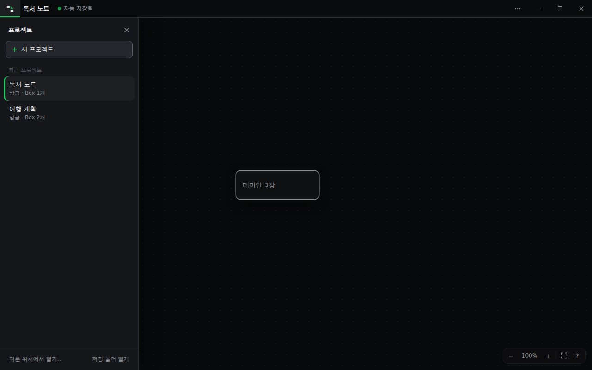

- 목록의 이름에 마우스를 올리면 ✎(이름 바꾸기) · 🗑(휴지통으로) 버튼이 나와요.
- 전환할 때 지금 보던 화면과 열린 탭이 그대로 기억돼요.
- 파일은 **이 PC의 `C:\Users\내 이름\ThoughtFlow`** 폴더에만 저장돼요. 인터넷(OneDrive 등)으로 올라가지 않아요.
  프로젝트 창 맨 아래에 저장 위치가 보이고, **저장 폴더 열기**로 바로 열 수 있어요.

---

## 🔍 찾기

**Ctrl+F** → 단어 입력 → 그 단어가 들어 있는 Box가 반짝이고 목록이 나와요. 목록을 누르면 바로 그 메모로 이동!

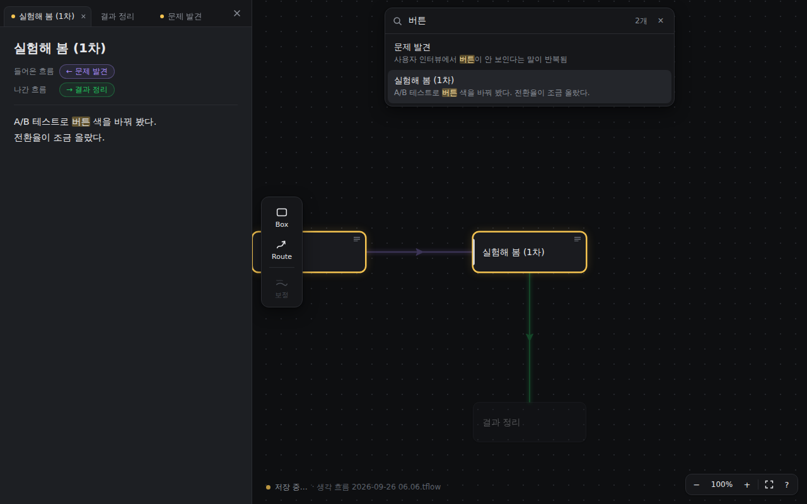

---

## ✦ AI와 함께 쓰기 (Claude · ChatGPT)

AI와 평소처럼 대화하면, **AI가 대화 내용을 보드에 Box와 선으로 정리**해 주고 **내가 적어 둔 생각을 읽고** 대답해요.
지금 쓰는 계정 그대로 쓰며, API 키나 추가 요금이 필요 없어요.

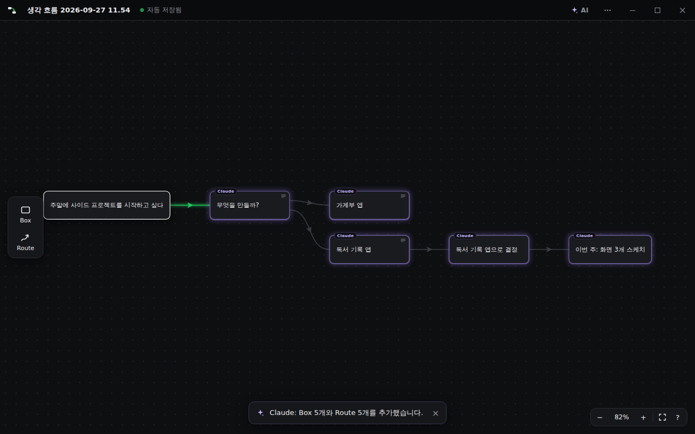

### Claude 연결 (1분)

1. [Claude 데스크톱 앱](https://claude.ai/download)을 설치하고 로그인
2. ThoughtFlow 위쪽 **✦ AI** → **Claude 데스크톱에 설치**
3. Claude에 뜬 창에서 **설치** → 끝!

### 🩺 Claude에 연결이 안 될 때

1. **✦ AI** → **연결 점검**을 누르세요. 무엇이 문제인지 ✓ ⚠ ✗ 로 알려 줘요.
2. 설치 창이 안 뜨거나 설치해도 안 되면 **설정 파일에 직접 등록**을 누르세요.
3. **Claude를 완전히 종료**하고 다시 켜요. (화면 오른쪽 아래 트레이의 Claude 아이콘을 오른쪽 클릭 → 종료. 창의 ×만 누르면 Claude가 계속 켜져 있어요)
4. 그래도 안 되면 **점검 결과 복사**를 눌러 그 글을 보내 주세요. 비밀 주소·토큰은 가려져서 복사돼요.

### 💬 ChatGPT 플러그인 · 웹/휴대폰 Claude

ChatGPT나 웹(claude.ai)·휴대폰의 Claude는 인터넷 주소로 연결해요.

1. **✦ AI** → **ChatGPT 플러그인 · Claude 웹** 스위치 켜기
2. **고정 주소**(추천)를 골라요 → [ngrok 무료 가입](https://dashboard.ngrok.com/signup) → [토큰 화면](https://dashboard.ngrok.com/get-started/your-authtoken)의 토큰 붙여 넣기 → **저장하고 연결**
   (가입이 싫으면 **임시 주소** — 대신 ThoughtFlow를 켤 때마다 주소가 바뀌어요)
3. 필요한 프로그램이 없다고 나오면 **자동으로 받기**
4. 나온 주소를 **복사**
5. **ChatGPT**: [chatgpt.com/plugins](https://chatgpt.com/plugins) → **추가** → **사용자 지정 MCP 서버 추가** → 이름 `ThoughtFlow`, URL에 붙여 넣기, 인증 **없음** → **만들기**
   **Claude 웹**: [설정 → 커넥터](https://claude.ai/settings/connectors) → **커넥터 추가** → URL에 붙여 넣기
6. 채팅에서 ThoughtFlow를 켜고 평소처럼 말해요.

> 🔒 이 주소는 내 보드로 들어오는 열쇠예요. 다른 사람에게 알려 주지 마세요. 알려졌다면 **주소 새로 만들기**.
> ThoughtFlow가 켜져 있을 때만 연결돼요.

### 이렇게 말해 보세요

- 💬 "지금까지 대화를 ThoughtFlow에 정리해줘"
  → Claude가 **새 프로젝트**를 만들고, 그 빈 보드에 생각·행동·결과를 Box와 선으로 그려 줘요.
  ThoughtFlow 창도 그 프로젝트로 바뀌어요. (다른 창을 보고 있었다면 작업 표시줄의 ThoughtFlow가 깜빡여요)
- 💬 "ThoughtFlow의 '여행 계획'을 보고 다음에 뭘 하면 좋을지 같이 생각해줘"
- 💬 "지금 보드의 '비행기 표' Box 뒤에 방금 정한 걸 이어서 적어줘"

### 안심하세요

- AI가 만든 Box에는 작은 **Claude / ChatGPT** 표시가 붙어요.
- AI가 무언가 바꾸면 아래에 알림이 뜨고, **되돌리기** 한 번이면 원래대로!
- AI는 기본적으로 **지우지 못해요.** (✦ AI 설정에서 허용했을 때만)
- 보드 파일은 이 PC에만 저장돼요. 다만 AI에게 부탁한 내용은 평소 대화처럼 그 AI 회사 서버에서 처리돼요.

> 🔄 **ThoughtFlow를 새 버전으로 설치했다면** ✦ AI → **Claude 데스크톱에 설치**를 한 번 더 눌러 주세요. Claude 쪽도 새 버전이 돼요.

> 더 자세한 설명 → [README의 AI와 함께 쓰기](../README.md#ai와-함께-쓰기-claude--chatgpt)

---

## ⌨️ 단축키 한눈에

| 키 | 기능 | 키 | 기능 |
|---|---|---|---|
| 더블클릭 | 새 Box | `Ctrl+Z` | 되돌리기 |
| 메모에서 `/` | 블록 메뉴 (그림 · 그래프도) | `Ctrl+B` | 메모 굵게 |
| `Enter` | Box 글 고치기 | `Ctrl+Y` | 다시 실행 |
| `Esc` | 글쓰기 끝 | `Ctrl+F` | 찾기 |
| `Tab` | 다음 Box로 | `Ctrl+S` | 바로 저장 |
| `R` | 자유 선 그리기 | `Ctrl+N` | 새 프로젝트 |
| `Delete` | 선택한 것 지우기 | `Shift+1` | 전체 보기 |
| 마우스 휠 | 확대 / 축소 | 빈 곳 드래그 | 화면 이동 |

---

## ❓ 자주 묻는 질문

**Q. 저장은 어떻게 하나요?**
A. 안 해도 돼요. 무엇을 하든 자동 저장돼요. 위쪽에 `자동 저장됨`이 보이면 안전해요.

**Q. 실수로 지웠어요!**
A. `Ctrl+Z`를 누르세요. 몇 번이든 되돌릴 수 있어요.

**Q. 오른쪽 창이 안 열려요.**
A. 창을 × 로 닫았다면 Box를 **더블클릭**하세요.

**Q. Box를 끌었는데 움직이지 않고 선이 나와요.**
A. 테두리를 잡은 거예요. Box **가운데**를 잡고 끌어 보세요.

**Q. 보드가 너무 커져서 어디 있는지 모르겠어요.**
A. `Shift+1`(또는 오른쪽 아래 ⛶)을 누르면 전체가 한 화면에 들어와요.

**Q. 프로젝트를 USB나 다른 PC로 옮기고 싶어요.**
A. 저장 폴더(`C:\Users\내 이름\ThoughtFlow`)에서 `프로젝트 이름.tflow` 파일과 **`프로젝트 이름.assets` 폴더**(첨부한 사진·파일)를 함께 옮기세요.

**Q. 정렬을 다시 눌렀더니 다르게 놓여요.**
A. 정렬 버튼은 누를 때마다 **→ 나가는 흐름 / ← 들어오는 흐름 중심**으로 바뀌어요. 버튼의 화살표가 다음에 할 정렬이에요. 마음에 안 들면 `Ctrl+Z`.

**Q. 앱을 껐다 켜면요?**
A. 마지막으로 쓰던 프로젝트가 그대로 열려요.

**Q. 예전에 `문서\ThoughtFlow`에 있던 프로젝트는요?**
A. 새 버전을 처음 켤 때 새 저장 폴더(`C:\Users\내 이름\ThoughtFlow`)로 자동 복사돼요. 원본은 그대로 남으니, 확인한 뒤 지워도 돼요.

**Q. 위쪽에 `저장 실패`가 떠요.**
A. 백신이나 Windows 보안이 폴더를 막고 있거나 디스크가 가득 찬 경우예요. `저장 실패`를 누르면 다시 저장해요.
계속되면 백신 설정에서 ThoughtFlow를 허용해 주세요.

**Q. Claude에 ThoughtFlow가 안 보여요 / 연결이 안 돼요.**
A. ✦ AI → **연결 점검**을 누르고 알려 주는 대로 하세요. 대부분 **설정 파일에 직접 등록** → **Claude 완전히 종료 후 다시 켜기**로 해결돼요.

**Q. ChatGPT에 넣은 주소가 안 돼요.**
A. **임시 주소**는 ThoughtFlow를 켤 때마다 바뀌어요. ThoughtFlow가 "주소가 바뀌었습니다"로 알려 주면 ChatGPT 플러그인의 주소도 바꿔 주세요. 매번 바꾸기 싫으면 **고정 주소**(ngrok)를 쓰세요.

**Q. 메모에 넣은 그림이 "찾을 수 없습니다"로 나와요.**
A. `프로젝트 이름.assets` 폴더에서 그 파일이 지워졌거나 옮겨진 거예요. 프로젝트를 옮길 때는 `.tflow` 파일과 `.assets` 폴더를 함께 옮기세요.

**Q. Claude가 "ThoughtFlow가 응답하지 않는다"고 해요.**
A. ThoughtFlow 창을 열어 위쪽 저장 상태를 확인하세요. 문제가 계속되면 ThoughtFlow를 껐다 켜고 다시 부탁하세요.

---

앱 안에서도 오른쪽 아래 **`?`** 버튼을 누르면 간단한 도움말을 볼 수 있어요.
